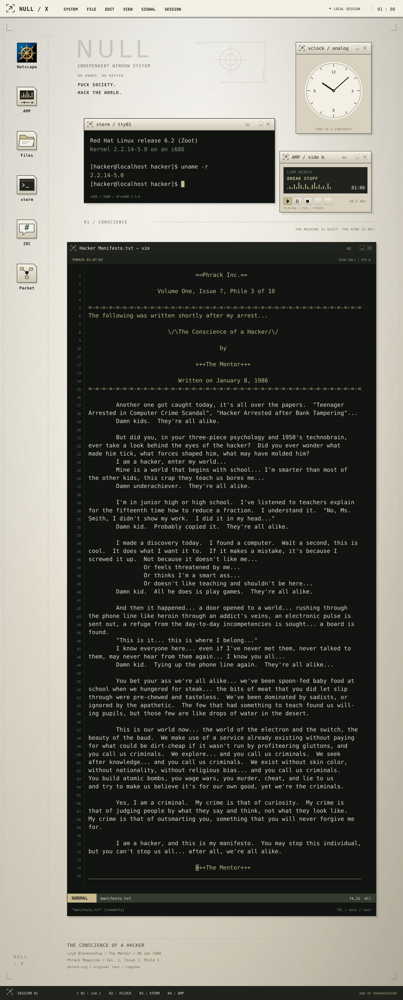

<a href="assets/session.txt">
  <picture>
    <source media="(max-width: 700px)" type="image/svg+xml" srcset="assets/hacker-desktop-mobile-b97cacd67f.svg">
    <source media="(max-width: 700px)" srcset="assets/hacker-desktop-mobile-b97cacd67f.png">
    <source type="image/svg+xml" srcset="assets/hacker-desktop-9348282b89.svg">
    
  </picture>
</a>
